# AI-Software-Factory-Lab

AI Software Factory is a software production system built around AI agents and automation. It turns business requirements into valuable software through standardized, verifiable development processes that continuously improve. This is the working definition used in this project.

The factory connects requirements and operational signals to verifiable changes, authorized delivery, outcome measurement, and continuous improvement. Its design follows four principles:

- **Evidence-Gated Execution**: Significant state changes require verifiable evidence. Missing evidence is marked `UNKNOWN`.
- **End-to-End Factory Observability**: Trace outcomes, delivery flow, and execution and decisions.
- **Enforced Autonomy Boundaries**: External permissions, policies, and authorized people control tools and delivery.
- **Replaceability by Design**: Use clear data contracts and interfaces to assess the cost of replacing models, agents, and platforms.

Value, delivery time, accepted output, and human productivity are assessed alongside quality and security thresholds. Actual outcomes must be measured after use.

## Agent relationships and workflows

The factory defines a shared `Software Delivery` workflow for all POCs. Each run receives a work item with its ID, requirements, candidate change, and acceptance criteria. PAY-482 is one example input. The Evidence Gate evaluates its evidence, and only `READY` proceeds to the agent flow. After proposals, Candidate Change applies the change in an isolated workspace and Candidate Verification runs acceptance tests. Passing results proceed through parallel verification, review, and the human review gate.

```mermaid
flowchart LR
    Input[Work item + evidence] --> Gate[Evidence Gate]
    Gate -->|READY| K[Knowledge Team]
    Gate -->|NOT READY / UNKNOWN| Stop[Gather evidence or revise]
    K --> P[Planner 02] --> O[Orchestrator 01] --> A[Architect 03]
    A --> C[Coder 04]
    A --> I[Infrastructure 06]
    A --> N[Integration 08]
    C --> Change[Candidate Change<br/>Isolated workspace]
    I --> Change
    N --> Change
    Change --> Verify[Candidate Verification<br/>Run acceptance command]
    Verify -->|PASS| J1((Join))
    Verify -->|FAIL / UNKNOWN| Rework[Gather evidence or revise]
    J1 --> T[Testing 09]
    J1 --> S[Security 11]
    J1 --> R[Reliability 20]
    T --> J2((Join))
    S --> J2
    R --> J2
    J2 --> Review[Reviewer 10] --> Risk[Risk & Approval 24]
    Risk --> Human[Await human review]
```

The three-to-three relationship shows that outputs from the parallel proposal stage enter parallel verification. Inspect each run for the actual inputs, outputs, and execution status. The Knowledge Team can delegate to Knowledge 25, Research 12, Memory 15, and Context 14. Actual delegation depends on the run. In the Agno POC, Testing, Security, and Reliability provide review recommendations, while Candidate Verification runs deterministic local tests.

The improvement workflow has a separate entry point and produces an improvement draft through **Observability Team → Governance Team → Improvement 26 → Optimization 19**. The Observability Team includes Observability 21, Evaluation 16, Benchmark 17, and Operations 23. The Governance Team includes Cost Control 27 and Audit 30. Each team delegates as needed, and improvement drafts require review before shared skills or prompts are updated.

The reference design also includes Research support for Planner, Memory support for Architect, Context support for parallel implementation, a return to Orchestrator after failed verification, rework after failed review, and Release 22 → Documentation 13 → knowledge ingestion after human approval. These relationships are recorded in [`definitions/reference_relationships.json`](definitions/reference_relationships.json). The current Agno workflow stops before human review and does not yet automate these paths. See [`definitions/workflows/README.md`](definitions/workflows/README.md) for the workflow definitions and current scope.

`definitions/` contains shared agents, teams, skills, and workflows. `scenarios/pay-482/` and `benchmark/` contain an example work item and expected outcomes. PAY-482 uses the shared workflow, agents, and skills, with its code changes and test results stored in the run's isolated candidate workspace. Each POC adapts the shared definitions and records its platform version, model, and execution evidence.

Run `python tools/validate_definitions.py` from the repository root to validate shared definition IDs and references.

## POC implementations

The repository includes three independent implementations of the shared AI Software Factory definitions. Each POC loads the repository's `definitions/`, `scenarios/`, and `benchmark/`, while keeping its own Compose project, credentials, data volumes, and generated run records. Initialize each POC's `.env` as described in its guide before starting it.

| POC | Runtime and tracing | Quick start from the repository root | Main local services | Guide |
| --- | --- | --- | --- | --- |
| Agno baseline | Agno AgentOS; Langfuse tracing | `Set-Location pocs/agno; docker compose build agentos backstage agent-ui; docker compose up -d` | AgentOS `:7777`, Agent UI `:3000`, LibreChat `:3080`, Backstage `:7007`, Langfuse `:3001`, report `:7778/report` | [Agno POC README](pocs/agno/README.md) |
| Agno + Grafana Tempo | Independent Agno AgentOS POC; OpenTelemetry OTLP/HTTP to Tempo; Grafana Explore | `Set-Location pocs/agno-tempo; docker compose -p agno-factory-tempo build agentos backstage agent-ui; docker compose -p agno-factory-tempo up -d` | AgentOS `:7877`, Agent UI `:3010`, LibreChat `:3090`, Backstage `:7107`, Grafana `:3002`, report `:7878/report` | [Agno + Tempo POC README](pocs/agno-tempo/README.md) |
| CrewAI | CrewAI API; optional Langfuse observability | `Set-Location pocs/crewai; docker compose up -d --build crewai-api` | API `:7790`; optional LibreChat `:3081`, Backstage `:7008`, Langfuse `:3002` | [CrewAI POC README](pocs/crewai/README.md) |

The Agno + Tempo POC is a separate variant of the Agno baseline: it preserves the Langfuse POC and sends its own OpenTelemetry traces to a local Tempo instance. Tempo uses local block storage, so this POC does not require MinIO. Its [Grafana Explore guide and verified trace link](pocs/agno-tempo/README.md#grafana-tempo-trace) explain how to inspect workflow spans.

CrewAI starts only its API by default. LibreChat, Backstage, and Langfuse are optional Compose profiles; see the [CrewAI guide](pocs/crewai/README.md#optional-independent-services) to start them. CrewAI's optional Langfuse service and Agno + Tempo's Grafana both default to host port `3002`; change `CREWAI_LANGFUSE_PORT` in `pocs/crewai/.env` if you need both observability UIs running at the same time.

All three implementations are local POCs. PAY-482 ticket state, CI, source control, and approval are simulated; candidate changes run in per-execution workspaces and do not update or deploy the product source. The POC-specific README files document setup, workflows, endpoints, tracing, results, and limitations.
