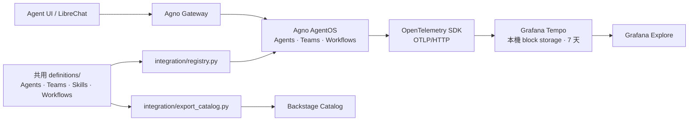
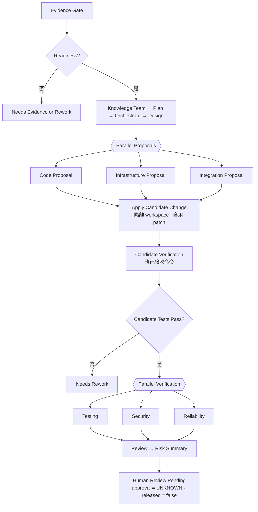
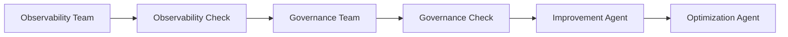
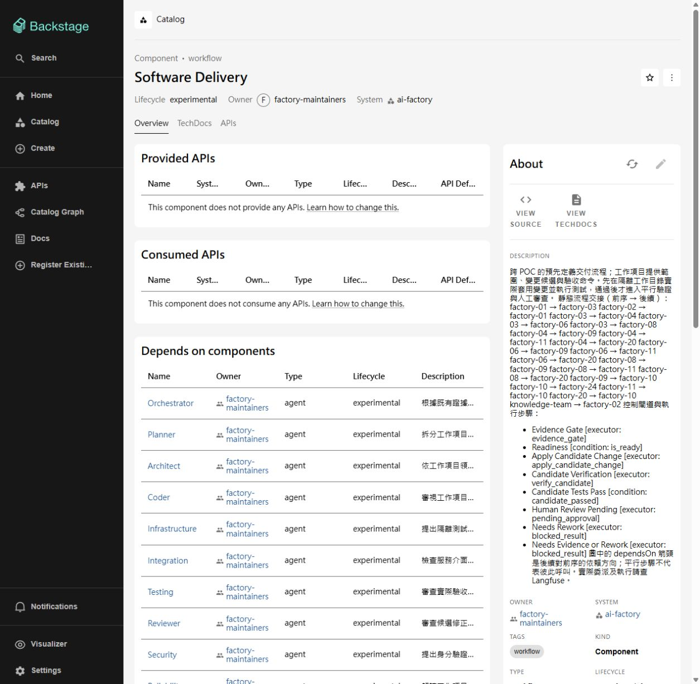
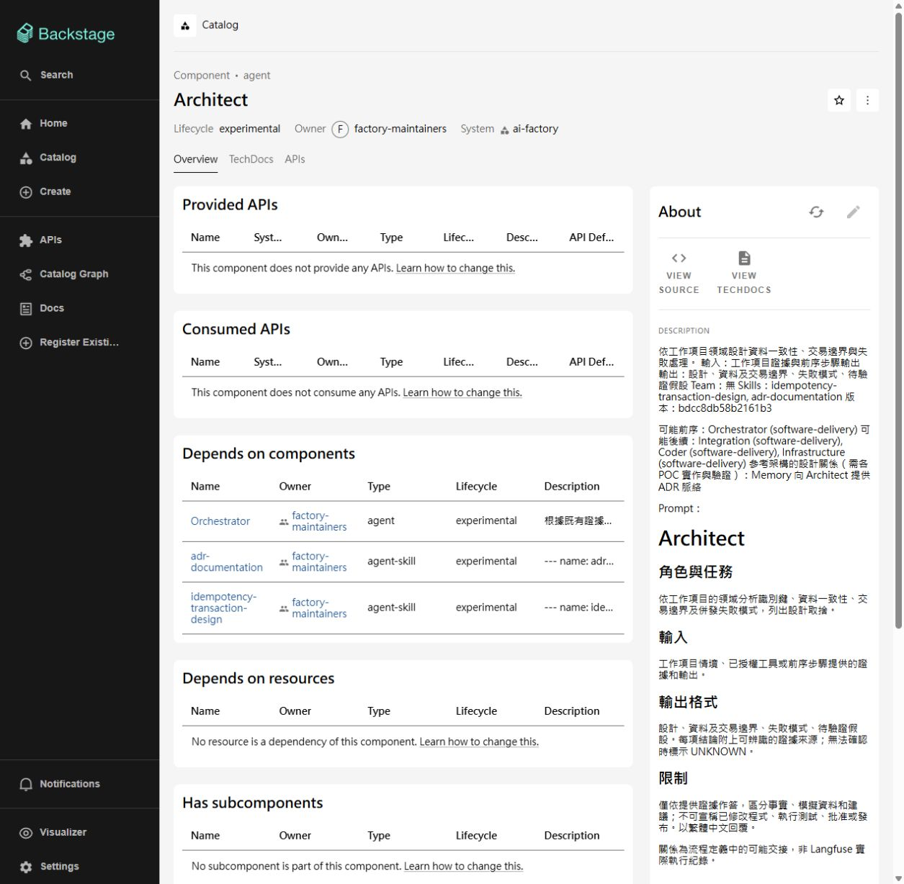

# Agno AI Factory：Grafana Tempo POC

這是以既有 Agno POC 為基礎建立的**另一套獨立 POC**。原本的 pocs/agno 保持原狀並繼續使用 Langfuse；本目錄 pocs/agno-tempo 使用 Agno AgentOS、OpenTelemetry OTLP/HTTP、Grafana Tempo 與 Grafana。兩套可同時啟動，使用不同 Compose project、主機埠、named volumes 與本機輸出。

本 POC 重用 repository 根目錄的 definitions/、scenarios/ 與 benchmark/。PAY-482 外部工單、CI、版本控制與人工核准仍是本機模擬；示範會實際呼叫已設定的模型服務。Workflow 在人工審核前停止，不會提交或部署產品程式碼。

## 服務與入口

| 服務 | 本機網址 | 用途 |
| --- | --- | --- |
| Agent UI | http://127.0.0.1:3010 | 手動呼叫 Agent 或 Team |
| AgentOS API | http://127.0.0.1:7877/docs | Agent、Team、Workflow API |
| Grafana | http://127.0.0.1:3002 | Explore 中查 Tempo trace |
| Tempo API | http://127.0.0.1:3200 | trace 查詢與 readiness |
| LibreChat | http://127.0.0.1:3090 | 對話介面 |
| Backstage | http://127.0.0.1:7107 | agent、team、workflow catalog |
| Gateway | http://127.0.0.1:7878/report | Workflow HTML 報告 |
| Agno PostgreSQL | 127.0.0.1:5632 | 本機除錯用 |

Compose 服務以 agno-factory-tempo 為 project name；所有對外埠僅綁定 loopback。OTLP receiver 4318 只在 Compose 網路中開放給 AgentOS。Tempo 使用本機 block storage，資料保留 7 天；Grafana datasource 已預先設定為 Tempo。此 POC 預設不部署 MinIO。

## 架構與資料流

根目錄 `definitions/` 是 Agent、Team、Skill 與 Workflow 的共用定義來源。新 POC 的 `integration/registry.py` 載入定義，`native_workflows.py` 將步驟建成 Agno `Workflow`、`Condition`、`Parallel`、`Step`，並以 AgentOS 執行。`integration/export_catalog.py` 另外輸出新 POC 專用的 Backstage catalog 與 LibreChat 設定。

每次執行由 AgentOS 建立 trace，透過 OTLP/HTTP 傳到 Tempo；Grafana 的 Tempo datasource 已預先設定。Workflow 結果報告將 Agno run/session ID、Tempo trace ID、業務結果及 span 查詢狀態並列，方便從執行結果跳到 trace。AgentOS run server span 會記錄 `agno.run_id`、`agno.session_id`、`agno.component.type` 與 `agno.component.id`。本地儲存不依賴 MinIO。

## Workflow 設計

Workflow 定義放在共用 `definitions/workflows/`；`native_workflows.py` 依定義建立 Agno 步驟。`executor` 代表本 POC 的受限程式步驟，`condition` 控制分支，`parallel` 讓多個提案或驗證工作並行。Backstage 中的 `dependsOn` 是由定義推導出的靜態流程關係；實際委派、先後順序與耗時以 Tempo trace 為準。

### Software Delivery

此流程以證據閘門與候選變更驗證為核心。工作項目的證據來自本機 fixture；通過 readiness 後，Agent/Team 先整理知識、計畫、協調與設計，再平行提出程式、基礎設施和整合變更。程式會把候選 patch 套用到每次執行專屬的隔離 workspace，先確認 baseline 能重現預期失敗，再執行驗收命令。只有驗證成功才進入平行測試、安全與可靠性檢視，之後由 Reviewer 與 Risk Summary 彙整，最後停在人工審核待辦。

人工審核是明確的停止點；這個 POC 不會提交、部署或發布產品程式碼。Readiness 不通過時進入補證/重工分支，候選測試失敗時只回報重工資訊，不會進入驗證與審核階段。

### Continuous Improvement

持續改善流程先由 Observability Team 檢視觀測證據，再執行程式化的觀測資料檢查；接著由 Governance Team 檢視治理證據並執行治理檢查。兩個檢查通過後，Improvement Agent 產生改善草案，Optimization Agent 整理優化方向。若缺少必要證據，檢查步驟會停止流程，不把缺資料當成通過。

## Backstage Catalog

Backstage 從新 POC 產生的 catalog 顯示 workflow、agent、team、skill、owner、revision 與靜態依賴關係。流程頁可讀取控制閘門與可能交接；Agent 頁顯示輸入/輸出、Team 成員、Skills 與 Prompt。圖上的依賴箭頭表示下游對上游的依賴，平行節點不表示彼此呼叫；真實執行關係應以 Grafana Tempo trace 核對。開啟[本機 Backstage](http://127.0.0.1:7107)可查看新 POC 目前產生的 catalog。

以下是隨基底 POC 複製的 Backstage 畫面參考。截圖中的說明文字保留了舊 POC 的 Langfuse 用語；目前新 POC 的 catalog 由 `integration/export_catalog.py` 重新產生，執行追蹤入口是 Grafana Tempo。

*Backstage Workflow entity：展示流程說明與依賴元件。此截圖是基底 POC 的畫面參考，非新 Tempo catalog 的即時截圖。*

*Backstage Agent component：展示 Architect 的角色說明與關係資訊。此截圖是基底 POC 的畫面參考，非新 Tempo catalog 的即時截圖。*

## Grafana Tempo trace

目前已驗證的 PAY-482 `ready` Software Delivery 執行包含 **91 個 spans**，根 span 是 `POST /workflows/{workflow_id}/runs`，總耗時約 **4 分 28 秒**。trace 中可展開 `Software_Delivery.arun`、條件與平行 proposal/verification、Agent/Team、LLM 與 Tool spans；LLM spans 可查看模型、token 數與時間資訊。

[直接在 Grafana Explore 開啟此 Workflow trace（5082bfe6fc74d8492dfa96b607b17014）](http://127.0.0.1:3002/explore?left=%7B%22range%22%3A%7B%22from%22%3A%22now-7d%22%2C%22to%22%3A%22now%22%7D%2C%22datasource%22%3A%22tempo%22%2C%22queries%22%3A%5B%7B%22query%22%3A%225082bfe6fc74d8492dfa96b607b17014%22%2C%22queryType%22%3A%22traceql%22%2C%22refId%22%3A%22A%22%7D%5D%7D&orgId=1)。此文件目前沒有附 Grafana 靜態截圖；請由上方 Explore 連結查看即時畫面。

## 前置需求與初始化

需要 Docker Desktop／Docker Compose v2 且 Docker Engine 正在執行、Python 3.9 以上、Git，以及可用的 OpenAI-compatible 模型 API key。第一次建置會下載多個映像與套件。

從 repository 根目錄執行：

\`\`\`powershell
Set-Location pocs/agno-tempo
python integration/setup_env.py
\`\`\`

編輯新 POC 專用的 .env，設定 OPENAI_API_KEY、OPENAI_BASE_URL 與 MODEL_ID。setup_env.py 會產生此 POC 的服務密鑰；不要複製原 POC 的 .env 或 Langfuse 金鑰。

## 建置與啟動

以下命令都從 pocs/agno-tempo/ 執行，並明確指定新 POC 的 Compose project：

\`\`\`powershell
docker compose -p agno-factory-tempo config --quiet
docker compose -p agno-factory-tempo build agentos backstage agent-ui
docker compose -p agno-factory-tempo up -d
docker compose -p agno-factory-tempo ps
\`\`\`

catalog-export 會在啟動時讀取根目錄共用 definitions/，產生新 POC 專用 catalog 和 LibreChat agent 清單。可用 Tempo readiness endpoint 確認服務狀態：

\`\`\`powershell
Invoke-WebRequest http://127.0.0.1:3200/ready
\`\`\`

Grafana 預設帳號來自 .env 中的 GRAFANA_ADMIN_USER 與 GRAFANA_ADMIN_PASSWORD。登入後前往 Explore，選擇已 provision 的 Tempo datasource；將 demo 報告中的 trace ID 貼入查詢欄即可檢視完整 trace。

## PAY-482 Agent demo 與 trace 驗證

在主機執行：

\`\`\`powershell
python demo_run.py
\`\`\`

此 demo 依序執行 stale、passed、timeout，核對 AgentOS 回覆及 check_ticket_readiness 結果，並以 W3C traceparent 關聯每次請求。在 Tempo 查詢到 Agent、LLM、Tool spans 才會通過追蹤驗證。結果寫入 swarm-output/demo-results.json 與 swarm-output/demo-report.html；驗證失敗時仍保留報告並回傳非零結束碼。

報告列出 trace ID、span 名稱與種類，不重製 Langfuse 的成本儀表板。實測 LLM spans 可在 Tempo 查到 `llm.model_name`、`llm.token_count.prompt`、`llm.token_count.completion`、`llm.token_count.total` 及快取讀取 token；Tempo span 的開始與結束時間可用來檢視耗時。provider trace 未提供成本欄位，因此目前不顯示費用。

AgentOS 的 run HTTP server span 會標記 `agno.run_id`、`agno.session_id`、`agno.component.type` 和 `agno.component.id`；`agno.session_id`／`session.id` 對應 AgentOS response 的 `session_id`。run ID 與 session ID 已以實際請求核對。

也可從 Agent UI 手動觸發請求，再到 Grafana Explore 查詢 trace。Agent UI 側邊欄預設 endpoint 是 localhost:7777；請開啟 endpoint 編輯功能，改為 http://127.0.0.1:7877，並使用由 .env 注入的 OS_SECURITY_KEY。LibreChat 會透過 Gateway 呼叫 AgentOS；此路徑亦可用 Grafana 中的 service name 與時間範圍確認 trace。

## AgentOS Workflow 與報告

從 AgentOS 容器執行四個 Delivery 情境：

\`\`\`powershell
docker compose -p agno-factory-tempo exec -T agentos python native_demo_run.py --delivery-only
docker compose -p agno-factory-tempo exec -T agentos python native_report.py
\`\`\`

若要連同 Continuous Improvement Workflow 一起執行，省略 --delivery-only。每個 Workflow 會建立 W3C trace context，結果及 benchmark 格式輸出至 swarm-output/native-results.json 與 swarm-output/benchmark-results.json。報告輸出為 swarm-output/native-report.html，可從 Gateway 的 /report 檢視。每個情境包含業務結果、AgentOS run ID、Tempo trace ID、查詢狀態與 Grafana Explore 入口。

factory_swarm.py 是未支援的舊版示範入口；本 POC 的支援路徑是 demo_run.py 與 native_demo_run.py。

## 定義部署

部署流程操作的 Compose 指令會固定使用 agno-factory-tempo project。先驗證共用定義，再執行部署：

\`\`\`powershell
python integration/deploy.py validate
python integration/deploy.py deploy
python integration/deploy.py status
\`\`\`

部署快照、active/last-good 標記與輸出留在本目錄 deployment/ 與 swarm-output/。舊版 bootstrap_definitions.py 已從新 POC 移除，definitions/ 以唯讀方式共用。

## 停止與資料

\`\`\`powershell
docker compose -p agno-factory-tempo down
\`\`\`

down 會移除新 POC 容器與網路，但保留 named volumes。再次啟動會沿用自己的 AgentOS、Grafana 與 Tempo 資料。原本 Agno／Langfuse POC 的服務和資料不受影響。若要刪除新 POC volumes，請先備份並另行確認目標 project。

