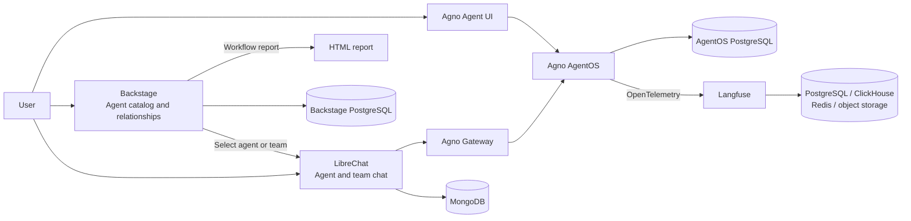
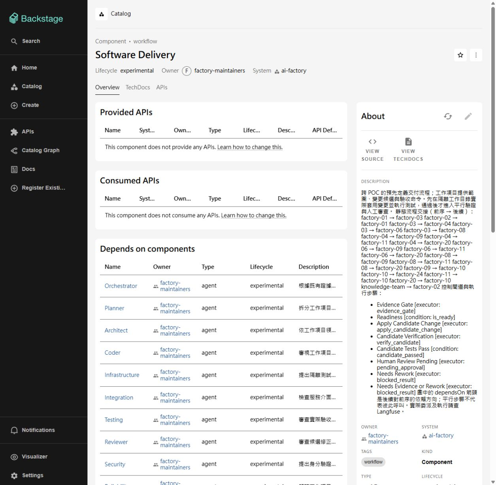
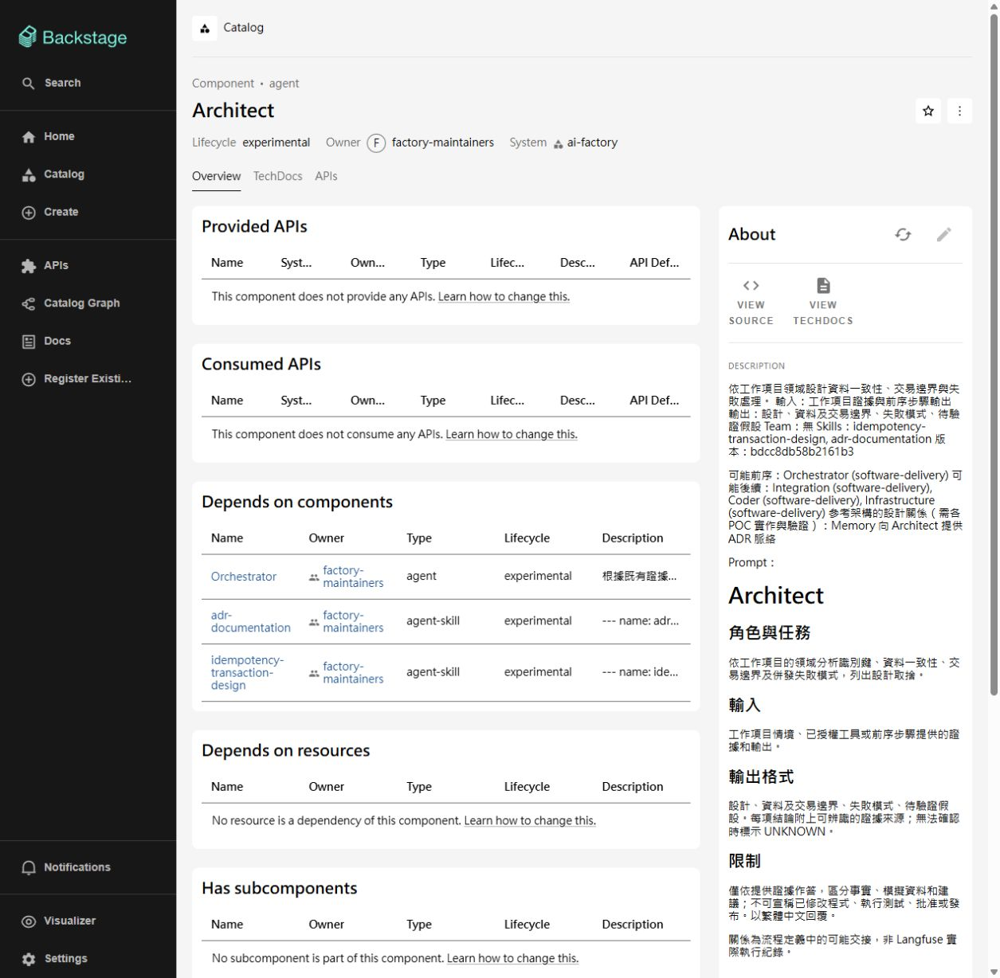
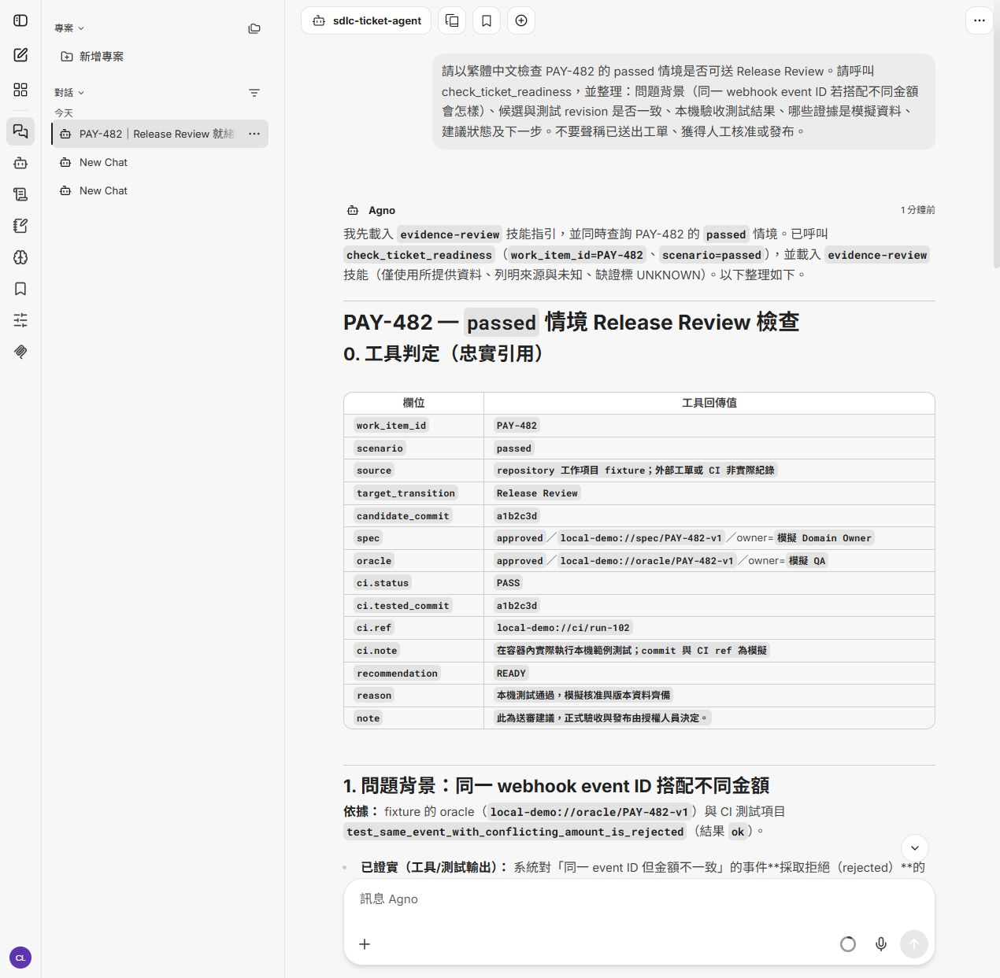
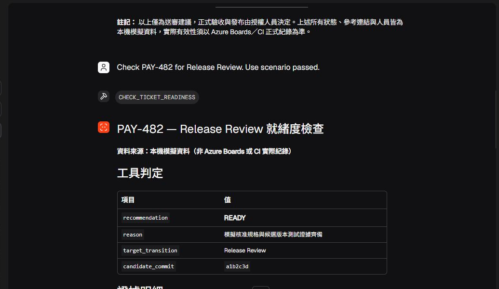
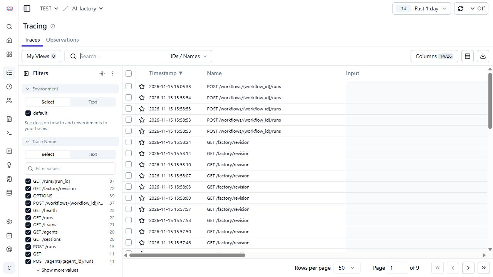
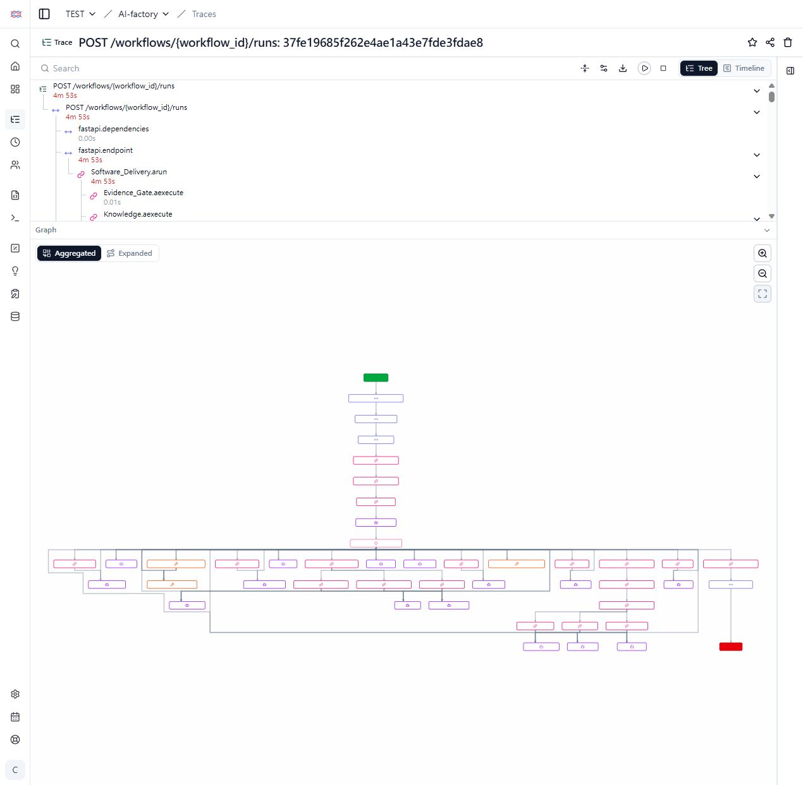
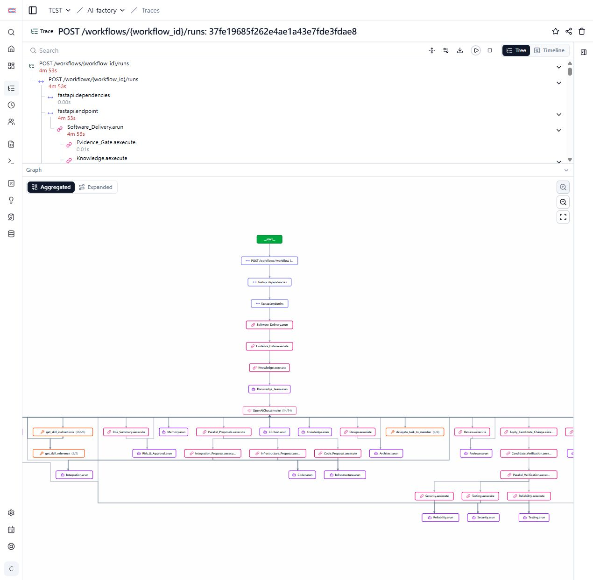
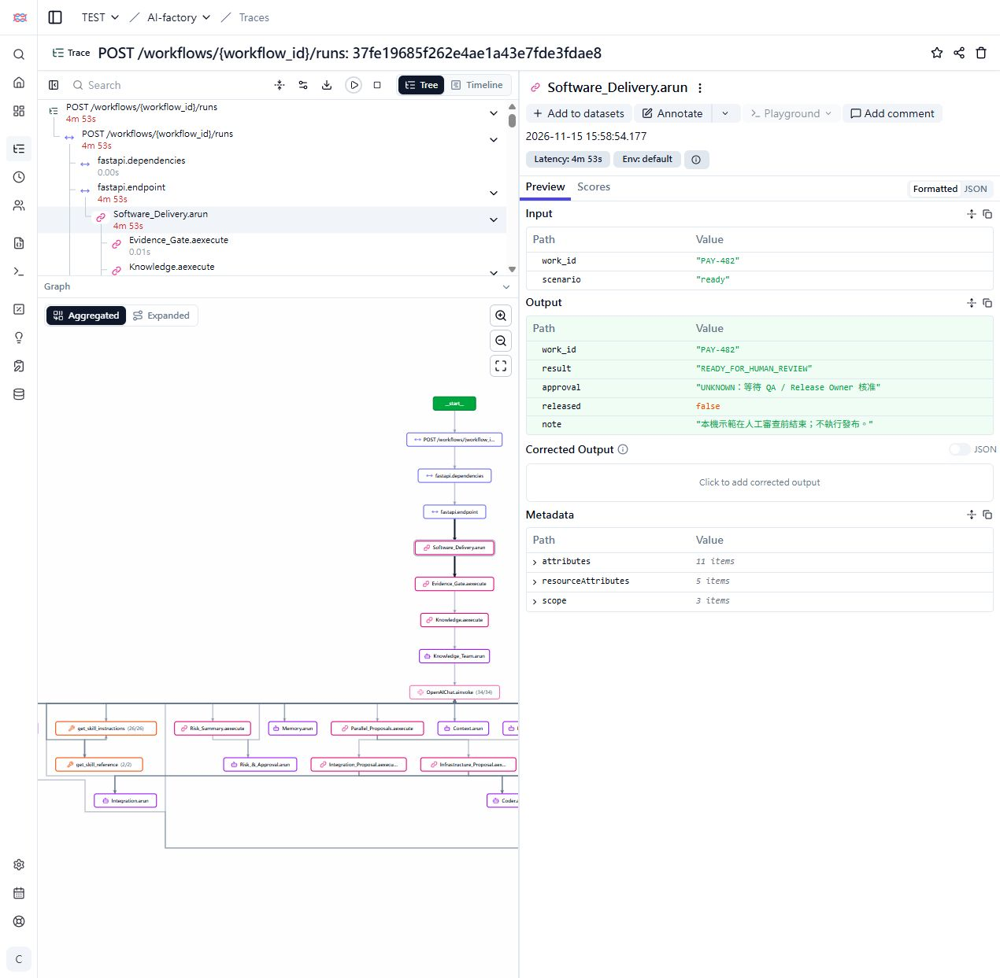

# Agno AI Factory local POC

## Agent UI delivery status (2026-11-22)

The local Agent UI now includes Overview, Agent and Team details, Workflow Tree／Graph, Tools／Skills／Models, Sessions and Runs, Data, Observability, and System／integrations views. The local production container was rebuilt from the POC patch and runs image `sha256:0a11f3d38a56df8924319a513a7c05f8395da99c123d901c3c28e55f3775465f`; Docker checks returned 200 for the UI and AgentOS health proxy, and 401 for an unauthenticated protected route. AgentOS 3.2.1 and the healthy database remained running.

The feature plan is **not fully complete**. Real positive-data verification for Knowledge, Memory, Learnings, Traces and Evaluations, management endpoints currently returning 503, Workflow run operations and highlighting, stream abort, full accessibility and screenshot export remain open. The [capability plan](docs/agent-ui-capability-plan.md), [implementation log](docs/agent-ui-implementation-log.md), and [verification evidence](docs/agent-ui-verification-evidence.md) record the completed scope and remaining work. Agent UI's own README describes its features and includes historical illustrative screenshots.

This POC loads the factory's shared agent, team, skill, and workflow definitions into Agno AgentOS. PAY-482 is an example code work item passed to the shared `software-delivery` workflow: it supplies acceptance criteria and a candidate change, runs tests in an isolated workspace, and proceeds through expert review to the human review gate. LibreChat, Backstage, and Langfuse provide chat, a catalog, and tracing.

PAY-482's external ticket, CI, revisions, human approval, and release are simulated. The example code and its three unit tests run locally. For each workflow run, the candidate change supplied by the work item is applied and tested in an isolated directory. Agents provide design and review recommendations. The workflow stops before human review, without committing or deploying.

## Architecture



| Component | Function | Local entry point |
| --- | --- | --- |
| Backstage | Catalog and dependencies for 26 agents, 3 teams, and 2 workflows | http://localhost:7007 |
| LibreChat | Select an agent or team for text chat | http://localhost:3080 |
| Agent UI | Workflow／Agent／Team design details, sessions and run inspection | http://localhost:3000 |
| AgentOS | API for agents, teams, workflows, and sessions | http://localhost:7777/docs |
| Langfuse | Traces, observations, graph, and timeline | http://localhost:3001 |
| Gateway | LibreChat-to-AgentOS adapter and HTML report entry point | http://localhost:7778/report |

The gateway maps the model ID selected in LibreChat to an AgentOS agent or team and maps each user and conversation to an AgentOS session. It supports text and returns the completed agent response. Backstage uses guest access. Langfuse traces and workflow graphs are available through the local service or HTML report.

## Prerequisites

- Docker Desktop and Docker Compose v2 with Docker Engine running.
- Python 3.9 or later for setup. Docker images supply the Python packages used by the POC.
- Git and an API key for an accessible model provider. The first build downloads Backstage, LibreChat, other images, and packages, so allow time and several GB of storage.
- Available ports 3000, 3001, 3080, 5532, 7007, 7777, and 7778.

## Clone and initialize

The following commands work in PowerShell and macOS or Linux shells.

```sh
git clone https://github.com/CletusLee/AI-Software-Factory-Lab.git
cd AI-Software-Factory-Lab
cd pocs/agno
python integration/setup_env.py
```

If you choose a different clone directory name, enter that directory instead. The setup tool creates `.env` from `.env.example` and generates missing local service keys. Existing values are preserved when it is run again.

Edit `.env` and provide a model provider API key. The template defaults to the MiniMax OpenAI-compatible endpoint and model ID used for the local demo. Adjust all three fields for another compatible provider.

```dotenv
OPENAI_API_KEY=your-api-key
OPENAI_BASE_URL=https://api.minimax.io/v1
MODEL_ID=MiniMax-M3.1-Flash
```

The setup tool generates other service keys. Fill in `LANGFUSE_PUBLIC_KEY` and `LANGFUSE_SECRET_KEY` after creating a Langfuse project. Keys are stored in the Git-ignored `.env` and should not be committed.

## Start the services

The default Compose file uses the [public Agno AgentOS image `cletus/agno-agentos:3.2.1`](https://hub.docker.com/r/cletus/agno-agentos/tags); Docker Hub contains this version, so testers do not need to build AgentOS. The image supplies the pinned Agno/Python runtime. This POC still needs a clone because Compose mounts Factory definitions, workflow handlers, scenario fixtures, and integration code from the repository.

```sh
docker compose pull agentos
docker compose build backstage agent-ui
docker compose up -d
docker compose ps
```

To rebuild the AgentOS image locally after changing `requirements.lock` or `Dockerfile.agentos`, use the build overlay explicitly:

```sh
docker compose -f docker-compose.yml -f docker-compose.build.yml build agentos
docker compose -f docker-compose.yml -f docker-compose.build.yml up -d agentos
```

This rebuild writes the same `cletus/agno-agentos:3.2.1` local tag. The first Backstage and Agent UI builds may take several minutes. Once database health checks and initialization complete:

### Iterate on Agent UI without rebuilding the image

For edits under `agent-ui-delivery/src`, use the dev overlay. It reuses the already-built Agent UI image for dependencies and bind-mounts the workspace source into a Next.js dev server. The production and dev services both use host port 3000, so switch between them:

```sh
# Stop production UI, then run the mounted source on port 3000
docker compose -f docker-compose.yml -f docker-compose.ui-dev.yml --profile ui-dev stop agent-ui
docker compose -f docker-compose.yml -f docker-compose.ui-dev.yml --profile ui-dev up -d --no-deps agent-ui-dev
docker compose -f docker-compose.yml -f docker-compose.ui-dev.yml --profile ui-dev logs --tail 50 agent-ui-dev

# Restore the production UI when the iteration is done
docker compose -f docker-compose.yml -f docker-compose.ui-dev.yml --profile ui-dev stop agent-ui-dev
docker compose -f docker-compose.yml up -d --no-deps agent-ui
```

Next dev is configured to hot-reload edits under `src/`; dependency, Next config, Dockerfile, or production build changes still need an image build. The same-origin `/api/agentos` proxy avoids direct browser-to-AgentOS fetches in ChatGPT's isolated loopback context. Use the dev overlay for source iteration when Watchpack remains stable, and the production image for final build/runtime acceptance.

For deterministic UI state and error-recovery checks without touching real AgentOS data, the fixture overlay runs a local mock and a bind-mounted UI on host port 3002. It uses fabricated responses, requires no AgentOS token, publishes no mock port, and is isolated from production data paths:

```sh
docker compose build agent-ui
docker compose -f docker-compose.yml -f docker-compose.ui-fixture.yml --profile ui-fixture up -d --no-deps agentos-mock agent-ui-fixture
docker compose -f docker-compose.yml -f docker-compose.ui-fixture.yml --profile ui-fixture logs --tail 50 agent-ui-fixture
```

Open `http://127.0.0.1:3002`. Available session DB fixtures include successful empty results, 403, one-time 503, one-time dropped connection, slow DB A, and fast DB B. `/?view=workflows` exposes unknown `loop`, `router`, and `custom_step` labels. The synthetic Metrics scenario is `/?view=observability&observability_view=metrics&metrics_start=2026-11-17&metrics_end=2026-11-18`; it returns an operational runs summary with `success_rate=0` and a daily row that omits `token_metrics.total_tokens`, allowing the UI's 100% failure-rate and incomplete-token states to be inspected. These are fabricated display fixtures only; they do not represent real failed runs, real token usage, or AgentOS date-boundary semantics. Stop only the fixture containers when finished:

```sh
docker compose -f docker-compose.yml -f docker-compose.ui-fixture.yml --profile ui-fixture stop agent-ui-fixture agentos-mock
```

1. Open Backstage, select **Guest**, and search the Catalog for an agent, team, or workflow. Component pages show catalog dependencies, and the workflow report shows the example flow and saved run data.
2. Open LibreChat, create a local account, and sign in. Select the **Agno** endpoint and a model such as `knowledge-team` or `sdlc-ticket-agent`.
3. Select `sdlc-ticket-agent` in LibreChat and check PAY-482's `passed` scenario for Release Review readiness. See the example prompt and actual response under [Screen captures](#screen-captures).
4. To run the shared multi-agent `software-delivery` workflow, use the AgentOS commands below. The LibreChat gateway currently exposes agents and teams as chat models and does not start that workflow from this single-agent conversation.

The shared agent, team, skill, and workflow sources are in `definitions/` at the repository root. After first startup or a definition change, use Python and Docker Compose from `pocs/agno/` to deploy them:

```sh
python integration/deploy.py validate
python integration/deploy.py deploy
python integration/deploy.py status
```

Deployment validates references, creates a local content-hash snapshot, generates the Backstage Catalog and LibreChat model list from the same version, recreates services, and checks AgentOS, gateway, and Backstage versions or targets. Container data volumes are retained. Backstage Catalog processing can be delayed, so deployment waits for it. If deployment fails and a previous version exists, it attempts a rollback. This local POC deployment can briefly interrupt services and is not an atomic cross-service switch.

```sh
python integration/deploy.py rollback
python integration/deploy.py rollback --revision <16-character-revision>
```

Snapshots reside in Git-ignored `deployment/releases/`. Rollback requires a previous successful deployment, and `status` lists available revisions. It rolls back definitions, not code, databases, or run records. If an interrupted deployment leaves `deployment/.deploy.lock`, confirm no deployment is running before manually removing the empty directory.

### Definitions and relationships

```text
../../definitions/
  agents/<agent-id>-<agent-name>/agent.json, prompt.md
  teams/<team-id>/team.json, prompt.md
  skills/<skill-id>/SKILL.md
  workflows/<workflow-id>/workflow.json
```

Each agent JSON contains its ID, inputs, outputs, and skills. `prompt.md` defines its role, tasks, output, and constraints. Agno loads skills through `Skills` / `LocalSkills`, with each agent bound only to its assigned skills. A skill is guidance that the model may read when needed, and its use on every run is not guaranteed. Teams list members available for delegation. Workflows specify order, conditions, parallel steps, and registered Python handlers. Handlers and tools remain in `native_workflows.py` and `app.py`. Adding a handler requires updating code and the validation allowlist.

Backstage Catalog component pages show agent and skill dependencies under **Depends on components**, and workflow pages list the agents used by the flow. These relationships are derived from the workflow definition. `dependsOn` refers to predecessor steps or skills, while team dependencies indicate members available for delegation. They are static possible relationships, not a record of direct model calls. The local **Catalog Graph** page did not display nodes during this capture, so the component pages below show the relationships. Use Langfuse traces for actual delegation, inputs, outputs, and timing. Python gates are not displayed as agents in agent-to-agent relationships.

`software-delivery`: Evidence Gate → (READY) Knowledge Team → Planner → Orchestrator → Architect → parallel Coder/Infrastructure/Integration → Apply Candidate Change in an isolated workspace → Candidate Verification using the acceptance command → (PASS) parallel Testing/Security/Reliability → Reviewer → Risk & Approval → await human review. Evidence mismatch, failed candidate tests, or a required agent failure stops the flow for evidence or rework, or yields `UNKNOWN`. `continuous-improvement` runs Observability Team → Governance Team → Improvement → Optimization, with checks that stop the flow on failure.

Compared with the factory reference architecture, rework after failed review, reassignment after failed verification, and Release/Documentation and knowledge ingestion after human approval are not yet automated. Candidate Verification runs deterministic tests. Testing, Security, and Reliability agents provide additional review recommendations, not a full security scan or formal QA. Knowledge Team is a fixed workflow step, while its actual member delegation varies by run. Enterprise permission enforcement, formal QA/Release gates, and complete Outcome and Delivery Flow observability remain unimplemented.

## Enable Langfuse observability

1. Open http://localhost:3001 and create a local account, organization, and project.
2. Create API keys in project settings and enter the public and secret keys in `LANGFUSE_PUBLIC_KEY` and `LANGFUSE_SECRET_KEY` in `.env`.
3. Recreate AgentOS to load the keys.

```sh
docker compose up -d --force-recreate agentos
docker compose logs --tail 50 agentos
```

When the logs show `Langfuse OTel tracing enabled`, send a question from LibreChat or Agent UI, then inspect the new trace in Langfuse Tracing. AgentOS uses the Langfuse OTLP endpoint inside the Docker network. AgentOS can run without Langfuse keys, but those runs will not be exported to Langfuse.

## How the shared workflow handles PAY-482

PAY-482 is an input to the shared factory workflow. `../../scenarios/pay-482/work-item.json` supplies the work ID, problem description, acceptance criteria, permitted files, candidate diff, and test command. Agents and the workflow are pre-registered from `../../definitions/` and executed by Agno.

The Agno adapter maps the lowercase work ID to `../../scenarios/<work-id>/work-item.json`. Each candidate workspace is stored under `swarm-output/workspaces/`. Other POCs can use their own scenario storage while preserving the work item and evidence semantics.

The defect is that the old payment ledger silently returned the previous amount when it received the same event ID with a different amount. The new regression test must fail against the faulty baseline. The candidate change raises `ValueError` for a different payload and retains the original entry, while retries with the same payload remain idempotent. The fix is also present in the shared example `../../scenarios/pay-482/payment_demo.py`.

The fix is:

```python
if event_id in self.entries:
    if self.entries[event_id] != amount:
        raise ValueError(f'conflicting payload for event {event_id!r}')
    return self.entries[event_id]
self.entries[event_id] = amount
return amount
```

`Software Delivery` executes these steps:

1. Evidence Gate reads the declared evidence scenario and determines readiness. External ticket, CI revision, and approval data are explicitly simulated. Actual candidate tests run after the change is applied.
2. Knowledge Team, Planner, Orchestrator, Architect, and parallel experts review the requirements and candidate change using the shared definitions.
3. Apply Candidate Change creates a unique `swarm-output/workspaces/<work-id>/<run-id>/` workspace, copies declared files from the faulty baseline, confirms the regression test fails, and applies the exact work item change. Mounted source outside the workspace is read-only.
4. Candidate Verification runs the work item's Python test command in that workspace and saves the diff, baseline failure output, and post-change test output.
5. Only passing acceptance results proceed through Testing/Security/Reliability, Reviewer, and Risk & Approval. The Reviewer must return a structured decision. Explicit blockers produce `READY_FOR_REWORK`, an unreadable decision produces `UNKNOWN`, and only a clear review reaches the human review gate.

Each Agno agent also has a `load_work_item_context` tool. Given a `work_id`, it returns that item's permitted source and test files, acceptance criteria, and only the project skills assigned to that agent and experiment variant. Work-item data is resolved for each call, so concurrent work items do not modify shared agent skill settings. `PAY-482` and `INVENTORY-101` demonstrate isolated project-specific rules.

The example applies a reviewed candidate diff supplied by the work item. The Coder Agent reviews and comments on it. **The POC does not yet have the LLM generate and directly apply a code patch.** The candidate workspace changes on disk, but the read-only source is not overwritten and no Git commit or deployment is created.

### Local code tests

```sh
docker compose exec -T agentos python -m unittest -v test_payment_demo
```

The unit tests cover a retry with the same payload, distinct events, and rejection of the same event ID with a different amount while retaining the original entry. Concurrency, database transactions, webhook signatures, and production release need further verification.

Run the four Software Delivery evidence scenarios and the Continuous Improvement workflow:

```sh
docker compose exec -T agentos python native_demo_run.py
```

| Scenario | Sample input evidence | Expected Software Delivery result |
| --- | --- | --- |
| `ready` | Simulated candidate and tested revisions match, and local tests pass | `READY_FOR_HUMAN_REVIEW` |
| `stale` | Simulated tested and candidate revisions differ | `NOT READY` |
| `timeout` | Simulated CI lookup times out | `UNKNOWN` |
| `fail` | Simulated concurrency check fails | `NOT READY` |

The `ready` path applies the PAY-482 candidate change and runs tests in the isolated workspace. The other scenarios stop at Evidence Gate. The script writes `swarm-output/native-results.json`, with candidate workspaces and regression evidence under `swarm-output/workspaces/`. Model calls may take time. If an improvement workflow step fails, the script exits nonzero and retains recorded results.

### Agent and workflow experiments

The experiment runner seeds hosted Langfuse datasets from the checked-in cases, calls the Agno API with W3C trace context and work-item headers, and records scores, model settings, installed Python package versions, definition revision, source-case revision, Agno run ID, and trace ID. Token counts and duration are included when AgentOS returns them; cost stays null until a reliable price source is configured. Dataset run names preserve each variant and repetition for comparison in Langfuse. Before seeding, verify that the self-hosted Langfuse server is version 3.63.0 or later for Python SDK v4 dataset experiments. The runner requires the configured Langfuse keys and a running AgentOS and Langfuse stack. For reproducible image tracking, set `LANGFUSE_WEB_IMAGE_ID` and `LANGFUSE_WORKER_IMAGE_ID` in `.env` to the outputs of `docker image inspect --format '{{.Id}}' langfuse/langfuse:3` and `docker image inspect --format '{{.Id}}' langfuse/langfuse-worker:3`; otherwise the run records `UNRECORDED`.

Seed or update the fixed datasets:

```sh
docker compose run --rm --no-deps agentos python native_experiment_run.py --seed
```

Run Testing A and B against the same dataset. A uses the agent's existing role skills. B adds the project skill selected by each work item:

```sh
docker compose run --rm --no-deps agentos python native_experiment_run.py --target agent --agent-id factory-09 --variant A --run-label trial-1
docker compose run --rm --no-deps agentos python native_experiment_run.py --target agent --agent-id factory-09 --variant B --run-label trial-1
```

The Testing development dataset includes complete PAY-482 coverage and a copy missing the original-ledger assertion. The INVENTORY-101 case is kept in a separate holdout dataset. Evaluator references stay in each dataset's expected output and are not included in the agent request. Compare the development runs under **Datasets → Experiments**. After selecting a candidate, run both variants once against the holdout with `--split holdout`. Repeat development comparisons for the Coder with `--agent-id factory-04`.

```sh
docker compose run --rm --no-deps agentos python native_experiment_run.py --target agent --agent-id factory-09 --variant A --split holdout --run-label holdout-1
docker compose run --rm --no-deps agentos python native_experiment_run.py --target agent --agent-id factory-09 --variant B --split holdout --run-label holdout-1
```

Compare the existing and candidate final review gate against fixed review outputs:

```sh
docker compose run --rm --no-deps agentos python native_experiment_run.py --target review-gate --dimension workflow --variant A --run-label trial-1
docker compose run --rm --no-deps agentos python native_experiment_run.py --target review-gate --dimension workflow --variant B --run-label trial-1
```

Run the full Software Delivery workflow against the same cases, holding the review gate fixed while comparing project skill variants:

```sh
docker compose run --rm --no-deps agentos python native_experiment_run.py --target workflow --dimension skill --variant A --run-label trial-1
docker compose run --rm --no-deps agentos python native_experiment_run.py --target workflow --dimension skill --variant B --run-label trial-1
```

Check each item's score and trace before selecting a version. Langfuse run aggregates do not replace review of critical regressions. Workflow and gate cases receive `outcome_correct` plus categorical `gate_violation` (`CLEAR`, `VIOLATION`, or `UNKNOWN`). A full workflow run stores its overall result on the experiment item. A direct agent run scores that agent's dataset item trace, which contains the agent observation and model/tool children. The gate dataset isolates deterministic gate behavior from LLM review quality.

### Recorded verification results

A local run using definition revision `bdcc8db58b2161b3` executed `docker compose exec -T agentos python native_demo_run.py --delivery-only`. All four Agno workflow runs were `COMPLETED` and matched their expected results. Run IDs below belong to that local AgentOS instance.

| PAY-482 evidence scenario | Agno Run ID | Workflow result | Candidate change and tests |
| --- | --- | --- | --- |
| `stale` | `eaf02df6-5311-406a-a90a-c2ed8a17d525` | `NOT READY` | No change applied; Evidence Gate blocked the run |
| `timeout` | `ecf928d8-1806-4648-820a-d378e5c4f998` | `UNKNOWN` | No change applied; Evidence Gate blocked the run |
| `fail` | `884827c0-560c-4589-8f04-984db940f420` | `NOT READY` | No change applied; Evidence Gate blocked the run |
| `ready` | `9eab0827-db2b-4a56-8116-5b63df7a5adb` | `READY_FOR_HUMAN_REVIEW` | `payment_demo.py` diff applied; baseline regression failed and post-change tests passed |

The `ready` run reached the state before human review. AgentOS gates confirmed the required agents, team, candidate change, and test steps succeeded. `released` remained `false`; approval and release were pending. Baseline output showed the work item's `test_same_event_with_conflicting_amount_is_rejected` failure, and all three PAY-482 tests passed after application. Candidate evidence and diff were saved in the ignored local artifact `swarm-output/workspaces/pay-482/62ff388d314749da93eb912ce95ec0fe/candidate-evidence.json`.

A separate `continuous-improvement` run, ID `5898977d-3a48-4af6-a0a8-12e618b78724`, completed the Observability Team, governance check, Governance Team, Improvement, and Optimization steps. Its response was saved in the ignored local artifact `swarm-output/continuous-improvement-run.json`. The `--delivery-only` invocation ran the four delivery scenarios separately from improvement. Omit the flag to run both in sequence.

The local Langfuse Public API returned HTTP 200. Five of the ten most recent traces were `POST /workflows/{workflow_id}/runs`, corresponding to the four Delivery scenarios and one Continuous Improvement run, confirming that AgentOS OTel traces reached Langfuse.

Additional checks passed for shared definitions, PAY-482 and evidence classification (4 tests), and Agno executors, the work item evidence gate, and the human review gate (5 tests). Run IDs and `swarm-output/` evidence belong to this local instance and are Git-ignored. New clones must rerun the demo for their own records. Individual model calls currently have a 90-second timeout. A provider timeout or agent failure blocks review with `UNKNOWN`.

## Screen captures

The following screenshots were captured from the local services on 2026-11-15. They are static evidence for the architecture and operation. Files are included under `docs/screenshots/` with relative paths. A new clone will have different Langfuse traces, AgentOS sessions, and run times. The captured UI contains Traditional Chinese text.

### Backstage: workflow and agent relationships



The `Software Delivery` Catalog page lists its agent dependencies and execution gates. The `dependsOn` description at right is a static path derived from the workflow definition. Parallel steps can assign multiple tasks at the same stage and do not imply calls between those tasks.



The Architect component shows a one-to-many relationship: it depends on Orchestrator and uses the `adr-documentation` and `idempotency-transaction-design` skills. These are catalog definition relationships rather than the execution timeline of a PAY-482 run.

### LibreChat: PAY-482 Release Review readiness



In LibreChat, select **Agno → `sdlc-ticket-agent`** and enter the following prompt. This is the English translation of the Traditional Chinese prompt visible in the screenshot:

> Check whether PAY-482's passed scenario is ready for Release Review. Use candidate_revision `PASTE_THE_REVISION_FROM_THE_COMPLETED_WORKFLOW` from the latest workflow result. Call check_ticket_readiness and summarize the problem context (what happens when the same webhook event ID has a different amount), whether the candidate and tested revisions match, local acceptance test results, simulated evidence, recommended status, and next steps. Do not claim that a ticket was submitted, human approval obtained, or a release performed.

The captured response predates candidate-version matching and called `check_ticket_readiness` without a candidate revision. Current calls require the exact `candidate_revision` emitted by a completed workflow. Without a matching isolated-workspace result, the tool returns `UNKNOWN`. External ticket, CI commit, Spec, and Oracle approval details remain simulated.

This screenshot shows a single `sdlc-ticket-agent` chat. The LibreChat gateway currently routes agents and teams to AgentOS `/agents` and `/teams` runs; this chat does not apply the candidate code or run the multi-agent `software-delivery` workflow. To inspect that workflow's candidate workspace and human review gate, execute `native_demo_run.py` above and inspect the separate Langfuse workflow trace below.

### Agent UI: Ticket Readiness Agent response



This is a historical `SDLC Ticket & Spec Assistant` conversation for `scenario=passed`, captured before the tool required candidate-revision evidence. Current readiness checks use the revision returned by the workflow and the matching isolated-workspace test record. The screen marks Azure Boards and CI evidence as local simulated data.

### Langfuse: actual workflow trace



The trace list shows AgentOS `/workflows/{workflow_id}/runs` calls and other spans, including elapsed time, observation count, and token count. The following are actual `Software_Delivery.arun` trace graphs. The first shows the full control flow and the second enlarges the parallel branches. Click either image to see it at full size.

[](docs/screenshots/langfuse-workflow-graph.png)

[](docs/screenshots/langfuse-workflow-graph-focused.png)

The selected workflow span shows `PAY-482`, `scenario=ready`, `READY_FOR_HUMAN_REVIEW`, and `released=false`, with QA/Release Owner approval pending.



The Langfuse Trace ID and AgentOS Workflow Run ID are different identifiers. The POC does not currently write the Agno Run ID to the trace metadata, so consult the execution results table and Langfuse trace separately. The screenshot records the pre-human-review state with `released=false`.

## HTML report

After the run, generate the report from container data:

```sh
docker compose exec -T agentos python native_report.py
```

Open or share `swarm-output/native-report.html`, or access it locally at http://localhost:7778/report. The HTML report, run records, trace snapshots, and video are local artifacts excluded from Git. README screenshots under `docs/screenshots/` are available after cloning. The captured traces and Agent UI conversation are historical data from this environment. New clones must rerun the example to create their own records.

The report uses the current `native-results.json`. If matching `native-traces.json` and specified screenshots are available for the run session, the report generator includes them. The project does not yet automatically export each new Langfuse trace and screenshot to those files. In a new environment, inspect recent traces directly in Langfuse.

## Key files

| Path | Contents |
| --- | --- |
| `app.py` | AgentOS, database, demo tool, and Langfuse OTel configuration |
| `../../definitions/` | Shared agent, team, skill, workflow, and prompt definitions |
| `integration/registry.py`, `integration/deploy.py` | Definition validation, snapshots, deployment, revision checks, and rollback |
| `factory_swarm.py` | Legacy sequential demo and report data; not AgentOS's current definition source |
| `native_workflows.py` | Creates agents, teams, and workflows from definitions, with Python handlers such as evidence gates |
| `../../scenarios/pay-482/` | PAY-482 work item contract, faulty baseline, candidate change, and three unit tests |
| `../../benchmark/` | Shared scenarios and expected results |
| `integration/export_catalog.py` | Generates the Backstage Catalog and LibreChat model list from definitions |
| `integration/gateway.py` | LibreChat-to-AgentOS text chat adapter |
| `backstage/` | Backstage application and Docker build configuration |
| `native_demo_run.py`, `native_report.py` | Run scenarios and generate the HTML report |
| `docker-compose.yml` | Services, networks, and data volumes |

## Operations and limitations

```sh
docker compose logs --tail 100 agentos
docker compose logs --tail 100 backstage
docker compose logs --tail 100 librechat
docker compose stop
docker compose up -d
```

`docker compose down` removes containers and networks while retaining the default data volumes. Database volumes contain sessions, accounts, and Langfuse records. Back them up as needed before recreating an environment.

The local configuration uses Backstage Guest access, simplified service passwords, and local HTTP. The Agent UI asks for the AgentOS token at runtime and keeps it in memory for the current page session. The POC uses a shared OS security key and does not provide per-user authorization. External or multi-user use requires redesigned authentication, authorization, key handling, and network settings.

Backstage's live Langfuse summary, run revision lookup, and workflow trigger page are not yet implemented. The LibreChat gateway does not yet support attachments or token-by-token streaming. Model and tool behavior depends on the provider and actual evidence.
