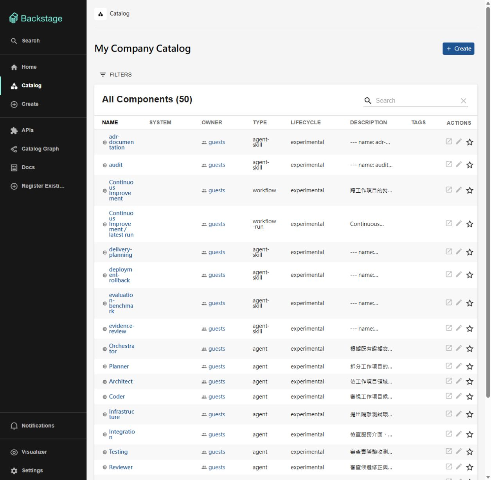
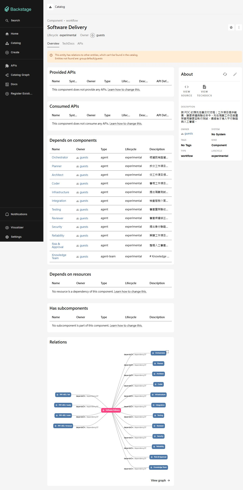
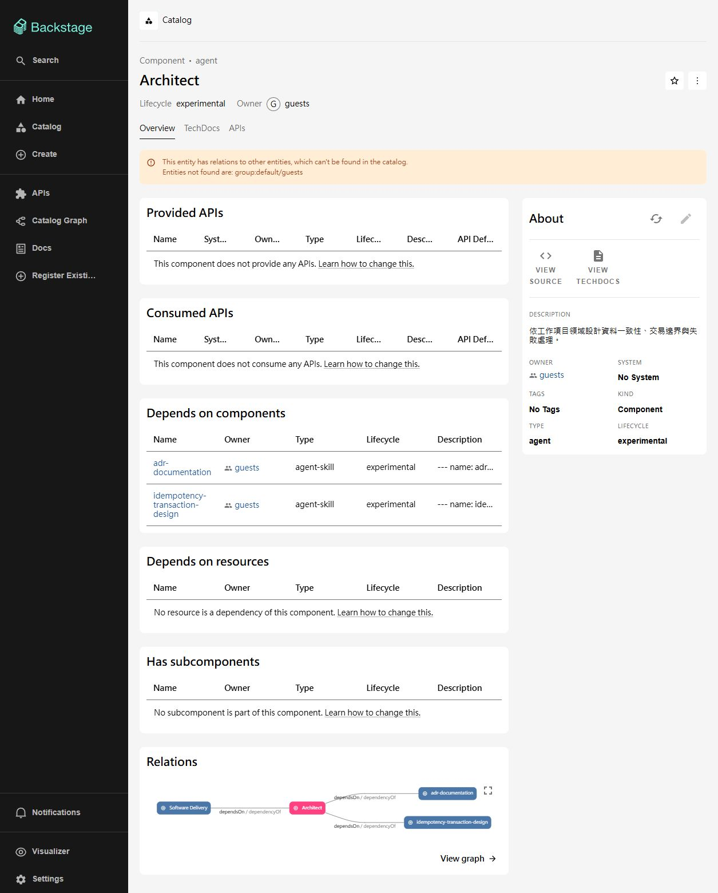
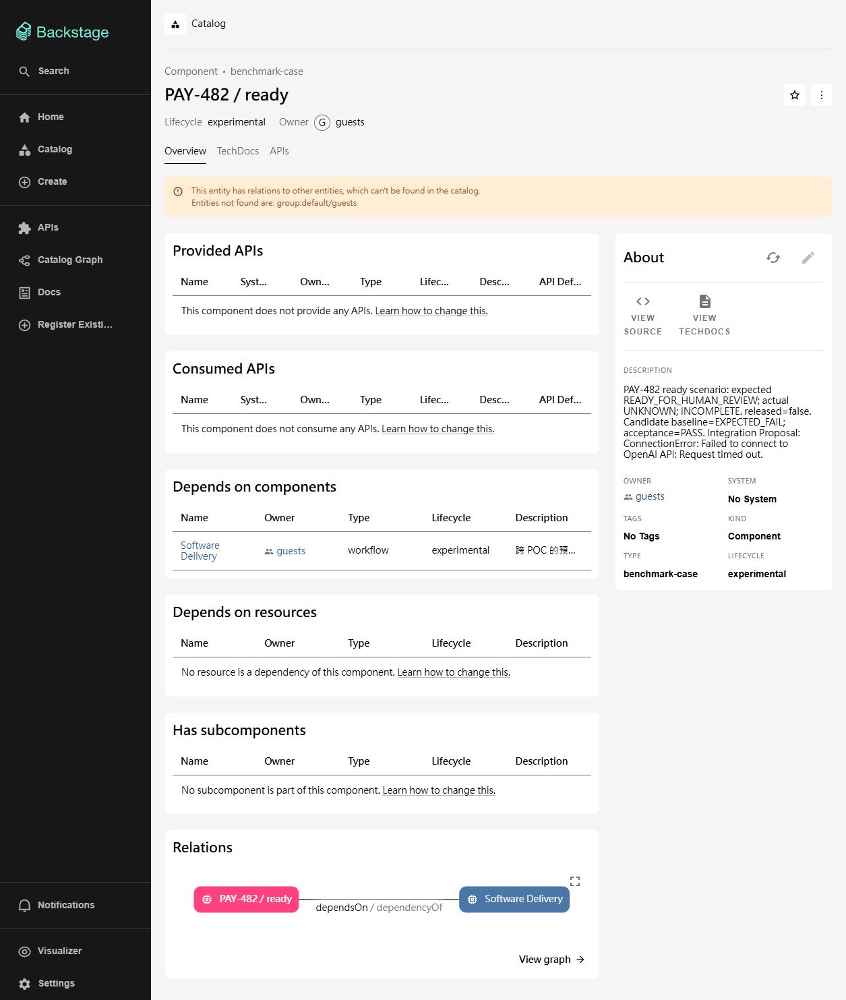
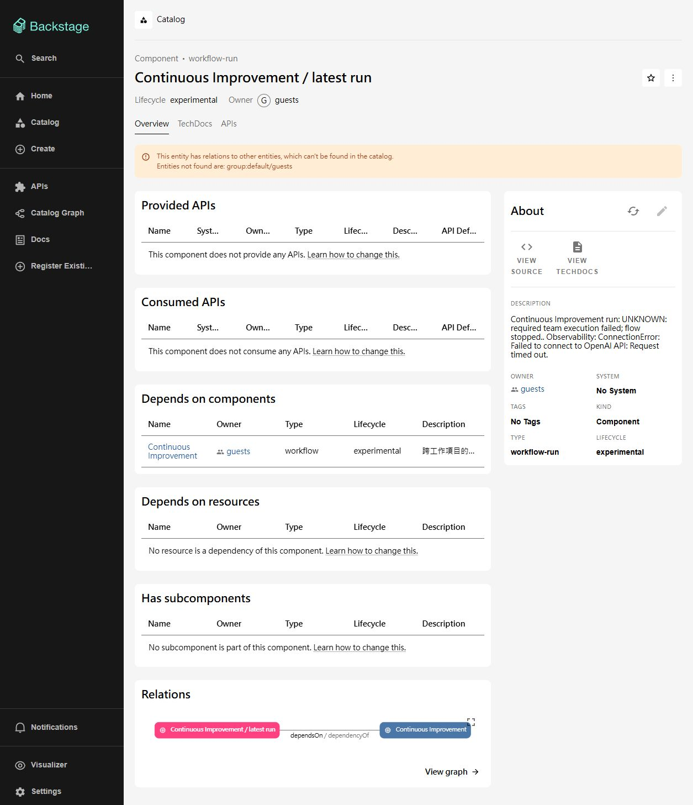

# CrewAI AI Factory POC

This is an independent CrewAI implementation of the local AI Factory POC. It reads the shared agents, teams, skills, workflow definitions, PAY-482 work item, and benchmark cases from the repository. Its Docker Compose project, API key, storage volumes, data directories, and host ports are separate from the Agno POC.

## Start the API

From this directory, copy `.env.example` to `.env` and set `OPENAI_API_KEY`. The default model and endpoint match the Agno example. Generate a private value for `CREWAI_API_KEY`. The API is the only service in the default Compose profile, so unit and workflow tests use little local memory.

```sh
docker compose up -d --build crewai-api
docker compose exec crewai-api python -m unittest discover -s tests -v
docker compose exec crewai-api python run_poc.py
```

The benchmark runs the four shared Evidence Gate scenarios and the Continuous Improvement flow. The `ready` delivery case applies the candidate patch only in a fresh `data/workspaces/` directory, checks that the baseline regression fails, and runs the acceptance tests after applying the declared change. No source checkout is patched, committed, or deployed.

To run only the four delivery cases, use `docker compose exec crewai-api python run_poc.py --delivery-only`. After saving those results, run only the Continuous Improvement flow with `docker compose exec crewai-api python run_poc.py --improvement-only`. Results, run records, and candidate evidence are saved under `data/` and ignored by Git.

To rerun a single delivery scenario without spending tokens on the other cases, use `docker compose exec crewai-api python run_poc.py --scenario ready`. The command updates that scenario in the saved benchmark and native run records.

## Optional independent services

These profiles run in the CrewAI Compose project and use their own data volumes and ports.

```sh
docker compose --profile ui up -d
docker compose --profile catalog up -d
docker compose --profile observability up -d
```

LibreChat is at `http://localhost:3081`, Backstage at `http://localhost:7008`, and Langfuse at `http://localhost:3002`. To start all services for a complete demonstration, run:

```sh
docker compose --profile ui --profile catalog --profile observability up -d --build
```

To send traces to the CrewAI Langfuse instance, create a Langfuse project, put its public and secret keys in `.env`, and restart `crewai-api`. Langfuse itself remains optional.

Stop the CrewAI POC while preserving its data volumes with `docker compose down`. `docker compose down -v` also removes its stored sessions, catalog database, and traces.

## HTTP endpoints

The API exposes an OpenAI-compatible chat endpoint at `/v1/chat/completions`, model discovery at `/v1/models`, and native execution routes at `/agents/{id}/runs`, `/teams/{id}/runs`, and `/workflows/{id}/runs`. API calls use `Authorization: Bearer $CREWAI_API_KEY`. Workflow run records include step results, status, duration, token usage when returned by the model, definition revision, and evidence paths. MiniMax does not return tokenizer counts through this endpoint, so CrewAI estimates tokens from text length; use those figures only as rough indicators, not as exact cost comparisons.

CrewAI `Agent`, `Crew`, and `Flow` objects perform the agent, team, and workflow work. Teams execute one task for each declared member. Parallel workflow nodes run their member steps concurrently and wait for all results. Agents with neither tools nor skills use one model iteration; agents with CrewAI skills and the ticket assistant use three so a skill or evidence tool call can be followed by a final answer. Any failed required agent step causes the human review gate to return `UNKNOWN` with `released=false`.

## Screenshots

These Backstage screenshots were captured from the running CrewAI POC on 2026-11-15. The catalog contains 45 definition entities and five entries for the saved benchmark and workflow run results.

### Catalog and agent relationships



The Software Delivery entity links the workflow to its 11 agents and Knowledge Team. Its relation graph also shows the four PAY-482 benchmark cases that use this workflow.



The Architect entity links to its declared `adr-documentation` and `idempotency-transaction-design` skills.



### Execution results



The saved PAY-482 `ready` run expected `READY_FOR_HUMAN_REVIEW` but returned `UNKNOWN` because the Integration Proposal agent timed out while connecting to the model API. Candidate verification recorded the baseline regression as `EXPECTED_FAIL` and acceptance tests as `PASS`; the gate correctly kept `released=false`.



The latest Continuous Improvement run also stopped with `UNKNOWN` after the Observability Team request timed out. These are the existing local run records; viewing the screenshots does not rerun the model or workflow.
